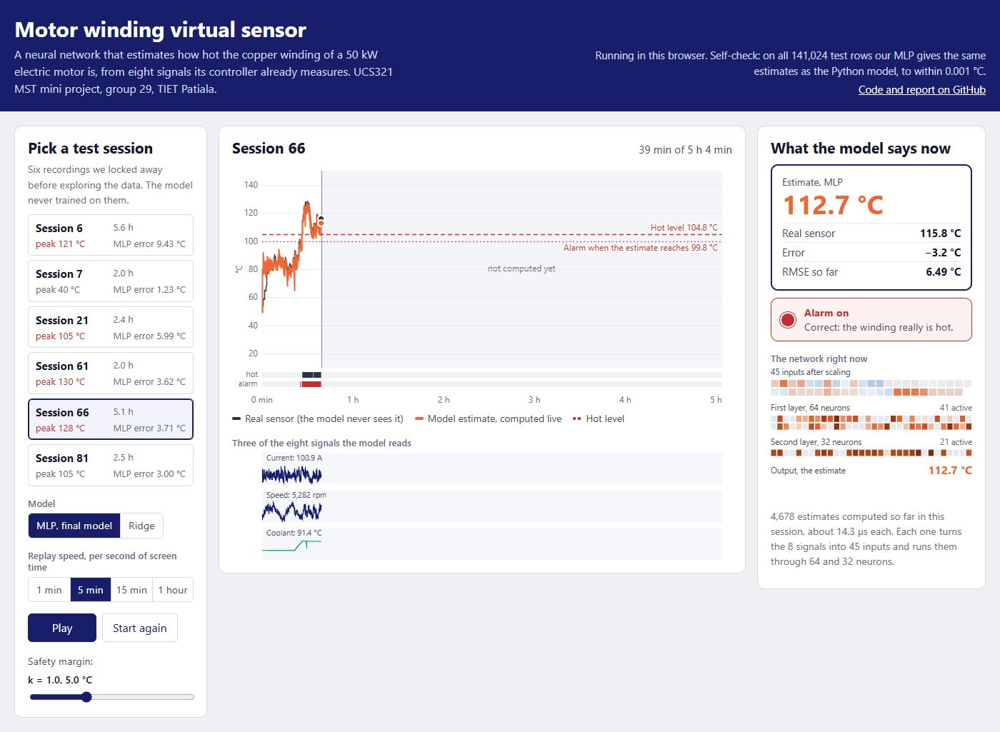
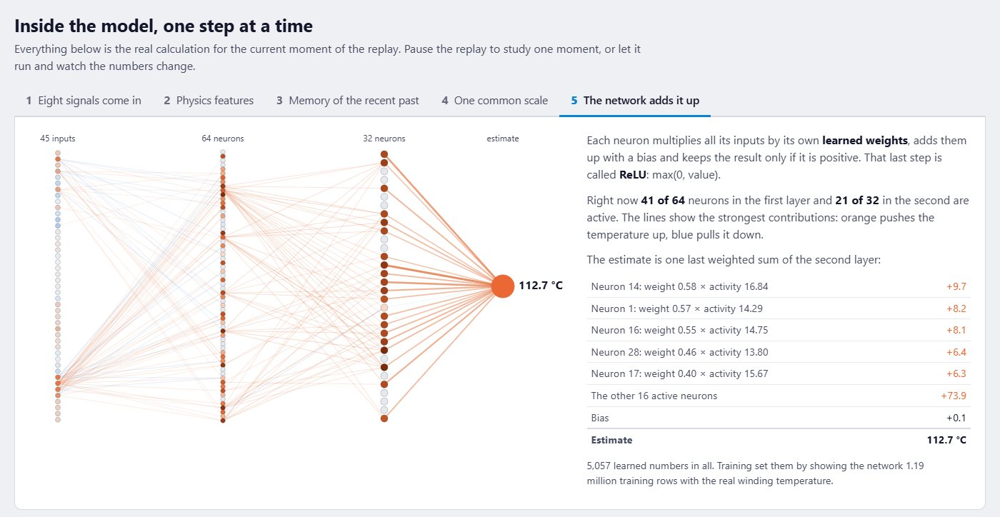
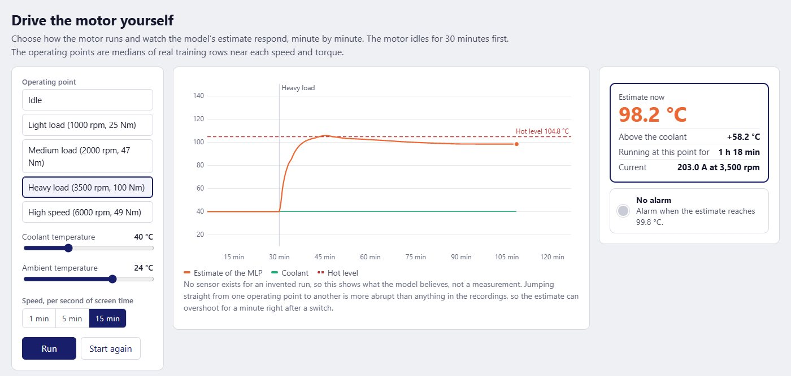
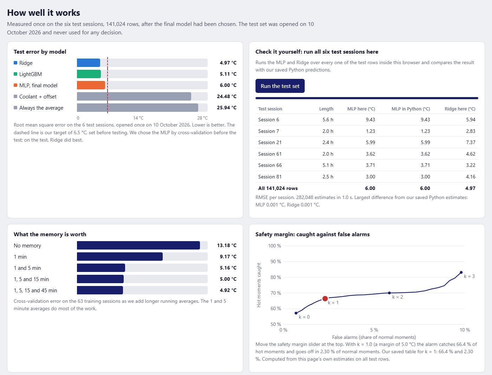
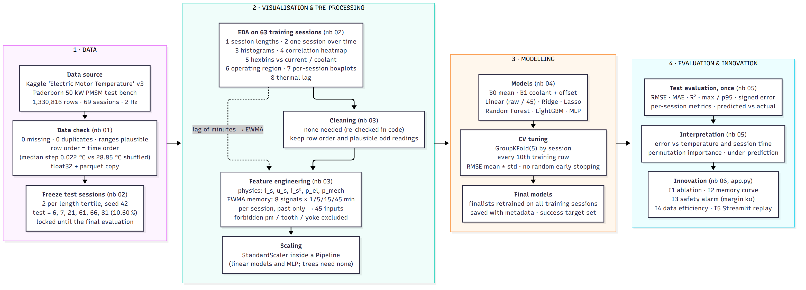

# Motor winding virtual sensor

A machine learning model that estimates how hot the copper winding inside an electric motor is, twice a second, from eight signals the motor's controller already measures. No temperature sensor inside the winding is needed. It comes with a demo that runs the trained network in the browser and shows, step by step, how each estimate is made.

UCS321 AI for Engineers, MST mini project, statement #6 (GE Power Systems scenario). TIET Patiala, B.E. ECE, Semester III, group 29.



| Result | Value |
|---|---|
| **What it estimates** | Stator winding temperature (°C) of a 50 kW permanent-magnet motor |
| **Inputs** | 8 controller signals, turned into 45 features (physics + running averages) |
| **Test error** | Final model (MLP) RMSE **6.00 °C**; Ridge 4.97 °C; LightGBM 5.11 °C |
| **Simple baseline** | Coolant temperature + an offset: 24.48 °C, so our models are 4 to 5 times better |
| **Biggest idea** | Running averages (thermal memory): without them the error goes from 4.92 to 13.18 °C |
| **Demo** | One HTML file that works offline with nothing to install |

## Contents

- [Open the demo](#open-the-demo)
- [What the demo shows](#what-the-demo-shows)
- [A five-minute demo script](#a-five-minute-demo-script)
- [The dataset](#the-dataset)
- [How the model works](#how-the-model-works)
- [Results](#results)
- [How the browser demo works](#how-the-browser-demo-works)
- [Run the notebooks and the Streamlit app](#run-the-notebooks-and-the-streamlit-app)
- [For teammates](#for-teammates)
- [Project folders](#project-folders)
- [Team](#team)
- [References](#references)

## Open the demo

The whole demo is one file, `demo/index.html` (4.5 MB). It carries the trained MLP and Ridge models, the six test sessions and our saved results inside it, so it needs no Python, no dataset download and no internet connection.

**1. Get the code.** Clone it:

```bash
git clone https://github.com/ArnavCodez/Ai-for-engineers-MST-project.git
```

```bash
cd Ai-for-engineers-MST-project
```

Or, without git: on the GitHub page press **Code**, then **Download ZIP**, and unzip it.

**2. Open the page.**

On **Windows**, double-click `demo\index.html` in File Explorer, or run this in Command Prompt or PowerShell:

```bash
start demo\index.html
```

On **macOS**, double-click `demo/index.html` in Finder, or run this in Terminal:

```bash
open demo/index.html
```

On **Linux**, open the file from your file manager, or run:

```bash
xdg-open demo/index.html
```

**Browser.** We tested it in Google Chrome; Microsoft Edge uses the same engine. Any current Firefox or Safari should work too, because the page only needs plain JavaScript (no graphics card features). Open the downloaded file itself: a preview inside WhatsApp, Google Drive or an email will not run it.

**First start.** The page takes a few seconds to start. In that time it runs the model over all 141,024 test rows and compares the answers with our Python results. When it is ready, the line at the top right says "Running in this browser" and how close the two are (0.001 °C).

## What the demo shows

**The workspace (top of the page).**
- **Pick a test session.** The six recordings we locked away before exploring the data. The model never trained on them. Session 66 is selected at the start.
- **Play.** Each estimate is computed as the replay moves: the page takes the 8 signals of that moment, builds the 45 features and runs them through the network. The chart only fills up to "now"; the grey part is not computed yet. Black is the real winding sensor, which the model never sees; orange is the estimate.
- **What the model says now.** The estimate, the real value, the error and the error so far. Below it, the activity of every input and neuron for this moment.
- **Safety margin and alarm lamp.** The alarm goes on when the estimate plus a margin (k × 4.96 °C) reaches the hot level, 104.8 °C. The lamp says whether the alarm is correct, a false alarm or a miss.
- **Model and speed.** Switch between the MLP (our final model) and Ridge, and replay at 1 minute, 5 minutes, 15 minutes or 1 hour of motor time per second.

**Inside the model, one step at a time.** Five tabs that follow the current moment through the model with the real numbers.

1. **Eight signals come in.** The 8 values and where each sits in the training range.
2. **Physics features.** Current magnitude, current squared (the copper loss), voltage magnitude, electrical and mechanical power, each with the numbers filled in.
3. **Memory of the recent past.** The 1, 5, 15 and 45 minute running averages of eight signals over the last hour, and all 32 of them in a table.
4. **One common scale.** Every input turned into a z-score: (value − training mean) ÷ training standard deviation.
5. **The network adds it up.** The 45 → 64 → 32 → 1 network with its strongest connections, how many neurons are active and the final weighted sum that gives the estimate.

   

**Drive the motor yourself.** Pick an operating point (idle, light, medium or heavy load, high speed), the coolant and ambient temperature, and watch the estimate respond minute by minute.



**How well it works.** Test error of every model against our 6.5 °C target, a button that reruns all six test sessions in the browser and compares them with Python session by session, the memory curve and the safety trade-off for the margin you set.



## A five-minute demo script

1. Open the page and point at the line at the top right: the browser gives the same estimates as our Python model.
2. Press **Play** on session 66. The estimate (orange) follows the real sensor (black) as it is computed.
3. About 6 seconds in, the winding goes above 104.8 °C. Press **Pause**: the lamp is on and says the alarm is correct. Drag the safety margin to 2 and see the alarm level drop to 94.9 °C.
4. Scroll to *Inside the model*. Open tab 2 for the physics, tab 3 for the running averages and tab 5 for the network.
5. In *Drive the motor yourself*, click **Heavy load** and **Run**. After 30 minutes of idling the estimate climbs over minutes, not instantly, because of the memory features.
6. In *How well it works*, press **Run the test set**. In about 2 seconds it gives MLP 6.00 °C and Ridge 4.97 °C, the same as our test notebook for every session.

## The dataset

We use the public **Electric Motor Temperature** dataset from Paderborn University (LEA department) on [Kaggle](https://www.kaggle.com/datasets/wkirgsn/electric-motor-temperature), version 3. GE is only the assignment's scenario; this is not GE data.

- A three-phase **50 kW permanent-magnet synchronous motor** on a test bench, sampled **twice a second** (2 Hz).
- **1,330,816 rows** in **69 recording sessions**, 184.84 hours in all. No missing values and no duplicate rows.
- One file, `measures_v2.csv`, 300 MB. Its source, version and checksum are in [`data/README.md`](data/README.md).

| Column | What it is | Use |
|---|---|---|
| `ambient` | Air temperature around the motor (°C) | input |
| `coolant` | Cooling water temperature (°C) | input |
| `u_d`, `u_q` | The two voltage components the controller applies (V) | input |
| `i_d`, `i_q` | The two current components (A) | input |
| `motor_speed` | Speed (rpm) | input |
| `torque` | Torque (N·m) | input |
| `stator_winding` | Winding temperature (°C), 18.59 to 141.36 °C | **target** |
| `stator_tooth`, `stator_yoke`, `pm` | Other temperatures measured inside the motor | **never used**: a motor without a winding sensor would not have them, and they would give the answer away |
| `profile_id` | Which session the row belongs to | splitting only |

**Our split.** Rows next to each other are almost identical (they differ by 0.022 °C on average), so a random split would put near-copies of test rows into training. We split by whole session, before exploring the data, with seed 42:

| Part | Sessions | Rows | Used for |
|---|---|---|---|
| Training | 63 | 1,189,792 | Exploration, features, 5-fold cross-validation grouped by session, final training |
| Test | 6 (sessions 6, 7, 21, 61, 66, 81) | 141,024 (10.6 %) | The final score, opened once on 10 October 2026 |

The split is saved in `outputs/results/split_profiles.json`, so everyone uses exactly the same one.

## How the model works

1. **Physics features.** From the currents and voltages we compute the current magnitude, current squared (copper heating is I²R), the voltage magnitude and the electrical and mechanical power.
2. **Thermal memory.** Copper heats up and cools down slowly: the winding follows a change in current about 2.5 minutes later. So for eight signals we keep exponentially weighted running averages over the last 1, 5, 15 and 45 minutes, using past samples only. That gives **45 inputs** in all.
3. **Scaling.** Each input is turned into a z-score with the training mean and standard deviation, inside the scikit-learn pipeline.
4. **Models.** We compared nine models on the same features and folds: two baselines, linear regression, Ridge, Lasso, Random Forest, LightGBM and a small neural network (MLP) with two hidden layers of 64 and 32 ReLU neurons. The MLP had the lowest cross-validation error, so we chose it as the final model before opening the test set.



## Results

All finalists were scored once on the 6 test sessions (141,024 rows).

| Model | What it is | Test RMSE | MAE | R² |
|---|---|---|---|---|
| Ridge | Linear regression with a penalty on large weights | **4.97 °C** | 2.99 °C | 0.963 |
| LightGBM | Gradient-boosted decision trees | 5.11 °C | **2.86 °C** | 0.961 |
| **MLP (final)** | **Neural network, 45 → 64 → 32 → 1** | **6.00 °C** | 3.69 °C | 0.946 |
| Coolant + offset | Baseline: coolant temperature plus the average gap | 24.48 °C | 20.15 °C | 0.106 |
| Mean | Baseline: always the training average | 25.94 °C | 22.22 °C | −0.004 |

- **Both targets met.** We set them before testing: RMSE at most 6.5 °C and at most half the coolant baseline (13.02 °C).
- **We kept the MLP.** It was best in cross-validation (4.92 °C) and came third on the test. Switching after seeing the test would mean using the test to make a decision, so we report it as it is.
- **Features matter most.** The same linear regression goes from 16.09 °C on the 8 raw signals to 5.18 °C on our 45 features. Removing only the running averages raises the MLP's cross-validation error from 4.92 to 13.18 °C.
- **Where it struggles.** In the first 5 minutes of a session (the averages have no history yet, MAE 12.34 °C against 3.47 °C later) and when the winding is hot, where it tends to read low. A safety margin of 2 standard deviations catches 70 % of hot moments at 5.84 % false alarms.

The full numbers are in `outputs/results/` (for example `test_metrics.csv`, `cv_results.csv`, `ablation.csv` and `safety_alarm.csv`), the figures in `outputs/figures/`, and the write-up in [`docs/report/report.md`](docs/report/report.md).

## How the browser demo works

- **Plain JavaScript, no libraries.** The network is small (5,057 learned numbers), so the page does the maths itself.
- **Our own weights.** `demo/build_demo.py` reads the saved scikit-learn pipelines and writes the scaler's means and spreads and every weight of the MLP and Ridge into the page.
- **Same features as training.** The page rebuilds the 45 features one sample at a time with the same formulas as `src/features.py`, and resets the running averages at the start of each session.
- **Checks itself twice.** Before writing the page, the build script reruns the page's maths in numpy and stops if it differs from our saved test predictions by more than 0.05 °C. When the page opens, it reruns all 141,024 test rows in the browser and reports the largest difference.
- **Data inside the file.** The 8 signals and the real winding temperature of the six test sessions are stored compressed inside the page. This is the one exception to our "no data in git" rule; see `CONTRIBUTING.md`.

To rebuild the page after changing anything in `demo/src/`, you need the data and the saved models (see the next section). Then, from the project folder with the virtual environment active:

```bash
python demo/build_demo.py
```

It rewrites `demo/index.html`. Never edit that file by hand.

## Run the notebooks and the Streamlit app

You only need this to retrain the models, rerun the notebooks or use the Streamlit app. The browser demo above needs none of it.

**What is not in git.** The dataset (`data/raw/`, `data/processed/`) and the saved models (`outputs/models/`) are too big for git. Both are in our submission zip. Without the zip, follow the steps below: one script downloads the data, and notebooks 03 and 04 train the models again.

**Python.** Use **Python 3.11**; newer versions can lack ready-made packages for some libraries. The versions are pinned in `requirements.txt`. The first install took about 19 minutes on one of our laptops.

### Windows

Make the virtual environment and install the packages (first time only):

```bash
py -3.11 -m venv .venv
```

```bash
.venv\Scripts\activate
```

```bash
pip install -r requirements.txt
```

Download the dataset (300 MB, no Kaggle account needed):

```bash
python src\download_data.py
```

Start the Streamlit app:

```bash
streamlit run app.py
```

If PowerShell refuses to run the activate script, use Command Prompt, or skip activating and run `.venv\Scripts\python -m streamlit run app.py`.

Or double-click `run_demo.bat`, which makes the virtual environment and installs everything on the first run, then opens the app at http://localhost:8501.

### macOS and Linux

On Debian or Ubuntu, install `python3.11-venv` first if the first command fails. On macOS, LightGBM needs the OpenMP library: run `brew install libomp` once.

```bash
python3.11 -m venv .venv
```

```bash
source .venv/bin/activate
```

```bash
pip install -r requirements.txt
```

```bash
python src/download_data.py
```

```bash
streamlit run app.py
```

The app opens at http://localhost:8501. It has three tabs:
- **Replay a test session:** the estimate against the real sensor, with the safety margin and the alarm lamp. Without the saved models it falls back to the predictions saved in Phase 5, so it always works.
- **Try your own values:** pick an operating point or type the 8 inputs and how long the motor runs there, and see how the estimate climbs. Needs the saved model.
- **Model performance:** all the tables and charts from `outputs/results/`.

### The notebooks

With the virtual environment active:

```bash
jupyter notebook notebooks/
```

| Notebook | What it does |
|---|---|
| `01_data_check` | Checks the CSV (shape, missing values, duplicates, time order) and writes `data/processed/measures_v2.parquet`, which the others read. Run it first. |
| `02_eda` | Freezes the test sessions, then explores the 63 training sessions (8 figures, thermal lag) |
| `03_preprocessing_features` | Builds the 5 physics features and the 32 running averages |
| `04_modelling` | Compares the nine models with 5-fold cross-validation, tunes them and saves the finalists (about 25 minutes with notebook 03) |
| `05_evaluation` | Scores the finalists on the test set. It was run once, on 10 October 2026; rerunning it repeats the same numbers but must never be used to change a model |
| `06_innovation` | Ablation, memory curve, safety alarm and data efficiency |
| `MST_final` | The whole project in one notebook, for reading |

The Streamlit app's *Try your own values* tab, `MST_final` and `demo/build_demo.py` need notebooks 01, 03 and 04 to have been run once.

## For teammates

**Read these in order.** Viva questions can go to anyone, so read all of them:
1. `PLAN.md`: the phases, the rules and the team split (plan v2)
2. `CONTRIBUTING.md`: how we work and how to log
3. `LOG.md`: everything we did, why, and every number, top to bottom
4. `docs/problem.md`: the problem in plain words
5. `CONCEPTS.md`: every concept explained simply
6. `VIVA_QA.md`: likely viva questions with our answers

**Every work session.**

```bash
git pull
```

Then read the last 3 entries of `LOG.md` and the phase checklist at the top of `PLAN.md`. Do your phase following `PLAN.md` and `CONTRIBUTING.md`, log every step in `LOG.md` (new concepts in `CONCEPTS.md`, new questions in `VIVA_QA.md`), then upload right away:

```bash
git add -A
```

```bash
git commit -m "Phase N: what we did"
```

```bash
git push
```

Only one person should run a phase at a time, so `LOG.md` never conflicts.

**Ground rules** (from `CONTRIBUTING.md`):
- **Test sessions 6, 7, 21, 61, 66, 81 were used once** (Phase 5). Don't tune anything on them now. Load the split from `outputs/results/split_profiles.json` and never redraw it.
- Use `src/config.py` for the target, the inputs and the forbidden columns. `pm`, `stator_tooth` and `stator_yoke` are **never** inputs.
- Every number in the slides or the report must come from a file in `outputs/results/`.
- Data, `.venv` and saved models are git-ignored; don't commit them. The only exception is `demo/index.html`.

**Other material.** The slides are `docs/slides/MST_Motor_Winding_Virtual_Sensor.pptx`. The interactive showcase (`showcase/`, built with `python showcase/build_showcase.py`), the live team tracker and the EDA explorer (`docs/showcase/index.html`) are published online; ask Arnav for the links.

| Phase | What | Status |
|---|---|---|
| 0 | Setup and data check (`notebooks/01_data_check.ipynb`) | done |
| 1 | Problem understanding (`docs/problem.md`) | done |
| 2 | Exploration, test sessions frozen first (`notebooks/02_eda.ipynb`) | done |
| 3 | Preprocessing and features: 45 inputs (`notebooks/03_preprocessing_features.ipynb`) | done |
| 4 | 9 models, 5-fold cross-validation by session; finalists MLP, LightGBM, Ridge (`notebooks/04_modelling.ipynb`) | done |
| 5 | Test set used once: MLP 6.00 °C, Ridge 4.97, LightGBM 5.11 (`notebooks/05_evaluation.ipynb`) | done |
| 6 | Ablation, memory curve, safety alarm, data efficiency (`notebooks/06_innovation.ipynb`), Streamlit app | done |
| 7 | Flow diagram, report, slides, `MST_final.ipynb`, showcase, browser demo | done |

## Project folders

```
demo/                browser demo: index.html (built, committed), build_demo.py, src/ (page source)
notebooks/           01 to 06 in the order above, plus MST_final
src/                 config.py, data.py, features.py, modelling.py, plotting.py, download_data.py
data/README.md       dataset source, version and SHA-256 (the data itself is not in git)
outputs/figures/     all PNG figures (eda_*, feat_*, model_*, eval_*, innov_*)
outputs/results/     every number we quote (JSON, CSV), including split_profiles.json and test_predictions.csv
outputs/models/      saved models (not in git)
docs/                problem.md, flow_diagram.md and .png, report/report.md, slides/, demo/ (screenshots), showcase/ (EDA explorer)
showcase/            interactive showcase: build_showcase.py and template.html (built pages are not in git)
app.py               Streamlit app (run_demo.bat starts it on Windows)
requirements.txt     pinned versions for Python 3.11
CONTRIBUTING.md      team rules: workflow, code style, logging formats
PLAN.md  LOG.md  CONCEPTS.md  VIVA_QA.md
```

## Team

Group 29: Arnav Aggarwal, Armaan Malhotra, Tanishq Vashistha, Ishita Sharma and Abhilasha Das. Supervisor: Dr. Jyoti Maggu. UCS321 AI for Engineers, Thapar Institute of Engineering and Technology, Patiala.

## References

- W. Kirchgässner, O. Wallscheid and J. Böcker, "Data-Driven Permanent Magnet Temperature Estimation in Synchronous Motors with Supervised Machine Learning: A Benchmark," *IEEE Transactions on Energy Conversion*, 2021 (arXiv:2001.06246). (The test bench and dataset.)
- Dataset: "Electric Motor Temperature," Kaggle `wkirgsn/electric-motor-temperature`, version 3.
- Insulation thermal classes and the 10 °C rule of thumb: IEC 60085; E. Cowern, "The Hot Issue of Motor Temperature Ratings," *EC&M*, 2000.
